# V5.0.7 使用说明与验收记录

本次从远程 main 的 PR #11 合并版本 e4a7159 开始。用户提供的 Windows 本地分支、补丁和设计图路径在云端不可访问；没有假定这些补丁已上传。核对远程实际实现后补入 axes_grid1 打包、固定电极说明刷新、失败点追溯、ISCC PATH 检查，并加入打包后 EXE 的真实模块／子进程验证。

## 安装与兼容

主程序 V5.0.7；可选 VIG 1.1.0，要求主程序至少 V5.0.7。两个安装器 AppId 均不改变。PLUX 格式扩展无需因主程序更新而重新安装；必须已启用且清单兼容。VIG 1.0.0 不含新集成入口，使用新功能请升级可选扩展。

**本分支不自动合并、创建 tag 或发布 Release。** 构建及验证结果在 Actions 的 `V5.0.7-installers-and-validation` 附件中，安装包旁附 SHA-256 文件。校验后再安装；不能以源码测试代替 Windows 打包验证。

## PLUX 导入

1. 扩展管理中确认 Sensofar PLUX 已启用且兼容。
2. 将 `.plux` 拖到原有主窗口，或使用原有文件选择入口。
3. 成功读取后，在原有“最近文件”列表重新打开。重复导入不会重复添加；失败文件不进入列表。

**扩展禁用或不兼容时不接受其格式的拖放；这不是扩展被主程序卸载。**

实际 PLUX 拖放后的主控页面，以及成功写入的最近文件菜单（合成测试文件）：

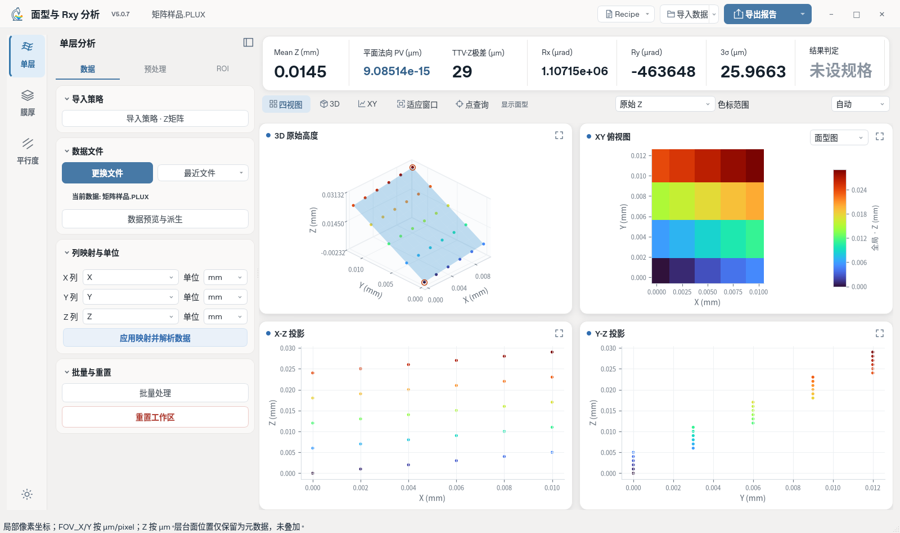


## 膜厚结果与五图报告

1. 按原流程在单层处理各文件并写入数据层。
2. 原“数据层”“配准”页面继续用于选择层、移动匹配点、设容差并检查配准图。
3. 进入“计算与导出”并计算。显示最终共同匹配点扣减后的 3D、XY、XZ、YZ 四视图。
4. 在膜厚模块直接导出报告：顶部为来源和指标，左侧四视图，右侧匹配图；匹配率、点数、距离／误差、容差来自同一次结果。

**载入其他单层文件不会替换此结果快照中的图、来源或匹配图。** 更改膜厚槽或配准后须按原流程重算。高度矩阵的 Z 若为表面高度，扣减代表相对面型变化，不能直接解释成绝对膜厚。

实际膜厚计算结果四视图：

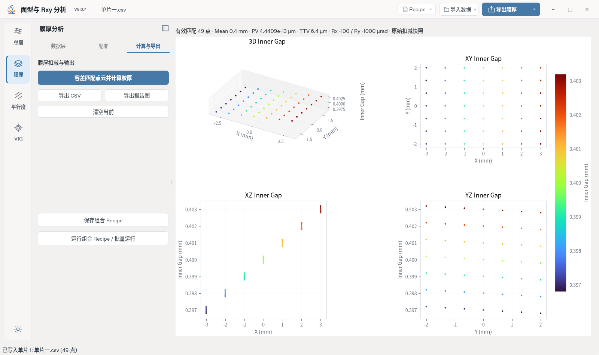

五图同页报告（长文件名换行、原配准位移及距离统计均来自结果快照）：

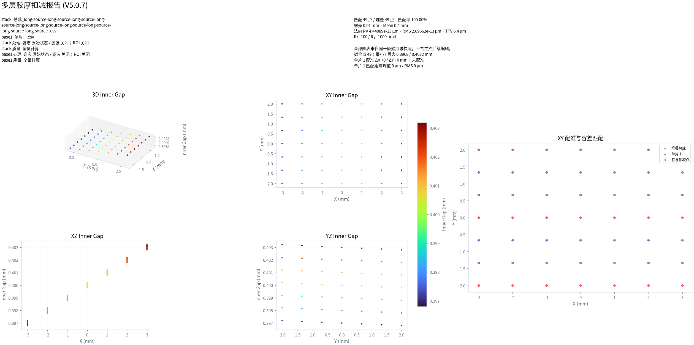

原数据层和配准页面见 [截图索引](v507-screenshots/README.md)。

## VIG 四视图与二次分析

1. 原有两层、三层和电极厚度含义及操作不变。在单层处理后分别写入；电极未写入时使用其固定值。
2. 设定原有 XY 匹配容差，计算 VIG。显示计算后的 `image` 四视图；报告保留既有 VIG 指标、质量、匹配及失败信息。
3. 点击“载入像面到单层二次分析”。原主控页面接收独立编辑副本；继续删点、撤销、ROI、滤波、显示面型和导出。

**像面图使用原始 image 符号，XY 为 mm、image 为 µm；载入主控只转换一次到内部 mm，不额外翻转。** VIG 原有平面拟合对 `-image` 的计算定义保持不变；主控按当前 Z 计算，倾角符号及 3σ 的口径可能因此与原 VIG 指标不同，不能混同。

**主控操作不重跑光线追迹，不改原始 VIG 结果。** 主控导出是编辑副本；回到 VIG 导出仍是原计算结果。来源、输入槽参数、质量及失败信息保存在内存来源元数据。没有文件可重放的编辑副本不能保存成文件型组合角色。

实际 VIG 结果与四视图报告：

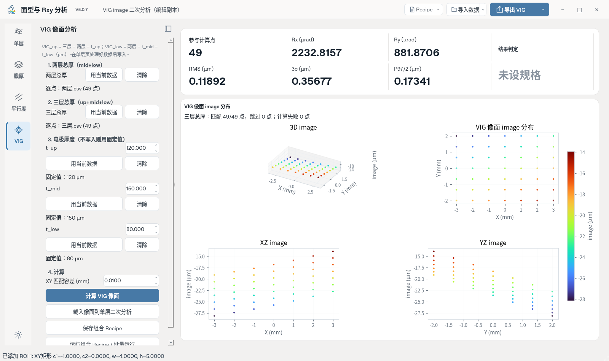

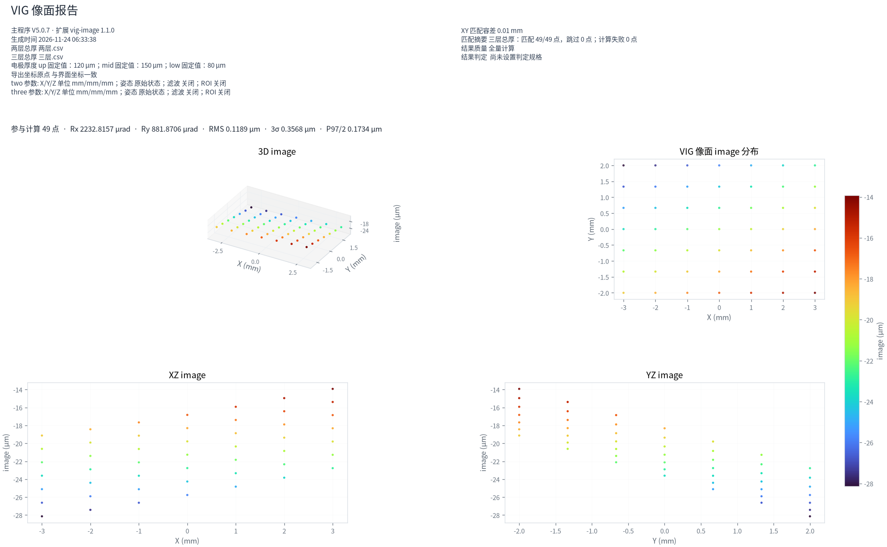

使用原主控进行 ROI、滤波、删点撤销和显示面型选择后的编辑副本：

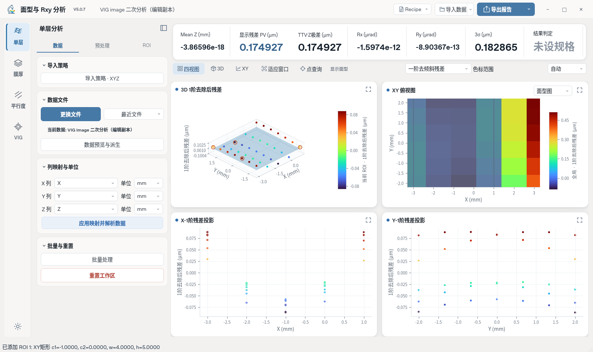

## VIG 组合 Recipe 与批量

详见 [组合 Recipe](composite-recipes.md#v507-可选-vig-集成)。每个电极独立保存文件／固定值模式；只有文件角色进入同一运行确认表和扫描规则。没有第二套向导、按文件顺序猜测或跨组借槽。

示例：上电极为文件，中／下电极为固定值；仍使用原运行确认表，未选择文件时会提示缺失并禁用开始按钮：

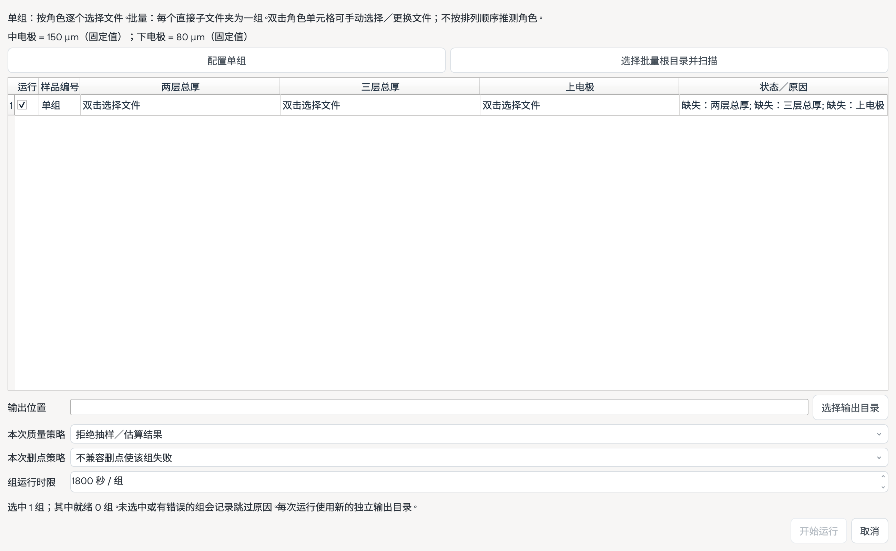

## 主控指标与判定

1. 每次启动六项指标全部勾选，上限全空，结果为“未设规格”；系统边框也不跨启动恢复。
2. 点击原有“结果判定”，在“单层指标与规格”页勾选顶部项目，按需填上限。只选两项时填满现有指标区；结果判定始终保留。
3. 留空表示不参与判定；`0` 是有效上限。取消勾选的项目既不显示也不判定。没有数据时显示 `--`，有规格时沿用待测状态。
4. 切换“显示面型”，Mean Z、PV、TTV、Rx、Ry、3σ 与同一有效显示 Z 同步。原始 Z 的 PV 保留原有平面法向残差定义；去趋势模式的“显示残差 PV”是当前残差 Z 极差，不再次去平面。TTV 为当前 Z 极差，Rx/Ry 按原平面拟合符号定义应用于当前 Z。
5. `3σ = 3 × std(Z有效, ddof=0)`；内部 Z 为 mm，界面换成 µm。采用总体标准差，所有路径相同。Rx/Ry 上限按绝对值，Mean Z 按有符号上限。

**σ 滤波选择“跟随当前去残差阶数”时，切换显示面型会按原有滤波器重新运行单层处理链。** 这会更新有效点；写槽时保存更新后的数据与参数，避免手动结果与 Recipe 重放不一致。固定阶数模式和滤波公式保持不变；后台处理未完成时不能写槽。

**显示面型不改写已写入的数据槽。** 膜厚／平行度／VIG 写槽仍使用原有滤波、ROI 后的单层处理数据，避免把显示残差当作测量厚度。CSV 保留兼容用的原始诊断字段，另用“当前显示面型实际指标”标记与顶部对应的数值；高阶面型不可用时明确标记不可用。

**主动载入 Recipe 可恢复该配方设置；这与每次启动的空规格默认不同。** 旧单层 Recipe 仍读取旧判断规格；膜厚／平行度／VIG 的既有指标定义不随主控改动。

从膜厚、平行度或 VIG 的结果判定卡片打开时，默认定位“膜厚／平行度／扩展规格”，保留原模块规格入口；主控卡片默认定位单层页。

不再重复显示小字残差 PV／RMS，仍保留拟合病态与面型不可用的质量警告。拟合失败或取消时，显示选择器返回实际使用的面型，避免选择器与图形、指标不一致。

原判定规格窗口中的单层选项（六项全选，上限全空）：

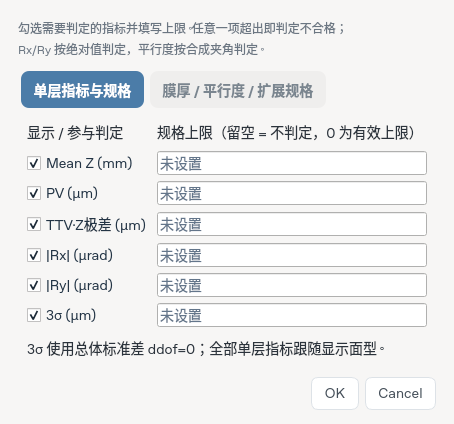

只选 PV 与 3σ 时仍填充原指标区，右侧保留结果判定：

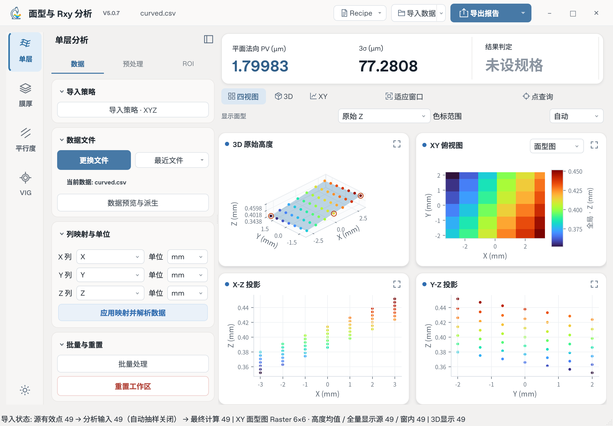

显示值为便于阅读进行舍入，判定使用同一指标的实际精度；悬停可查看更多数位。

## 浅色与深色模式

修改前 main（V5.0.6）在深色系统调色板下使用浅色 UI，弹出层四项确实存在，但未选项对比度很低：

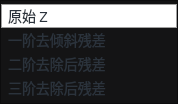

修复后的浅色／深色弹出层，包含普通、悬停／焦点及禁用项状态：

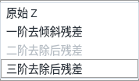

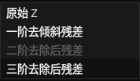

## 验证方法与边界

仅运行带总超时的定向测试，不运行已知存在失败／卡住的完整套件。可复现命令：

```bash
python -m pytest tests/test_v507.py tests/test_vig_module.py tests/test_composite_workflow.py tests/test_gap_registration.py tests/test_theme.py tests/test_judgment.py tests/test_module_host.py tests/test_format_extensions.py -q
python -m surface_analyzer --check-v507 --vig-extension extensions/vig-image --output-json v507-check.json
python -m surface_analyzer --check-v507 --output-json without-vig-check.json
```

外层需设置合理超时（CI 有步骤超时）。`--check-v507` 使用临时本地数据和独立 QSettings，实际渲染页面／报告、启动真实组合子进程，不依赖用户文件；输出 JSON 与 `*-views` 截图目录。打包 EXE 使用同样入口。

本地已验证：PLUX 接受拖放与最近文件、每次启动默认、显示面型数值与判定、空值与零规格、三电极八种模式的列配置、各槽冻结参数、真实 VIG 子进程结果一致、编辑副本单位／符号／隔离、部分光线失败追溯、长文件名报告、浅／深色真实弹出列表、膜厚和平行度原组合流程。浅色缺字问题已在旧代码与旧深色系统调色板下重现并保存前后截图。

Windows 打包、隔离安装／覆盖升级结果以本分支 Actions 实际运行结果及 JSON 为准；交付目录会强制核对两个安装包的 SHA-256、主程序来源提交、全部测试结果以及安装／升级验收 JSON，全部通过后才生成可上传的交付目录。自动窗口测试覆盖切换边框、缩放尺寸、最小化、最大化和恢复；真实人工鼠标拖动、系统窗口管理器和用户设备高 DPI 仍需人工复核。测试数据为合成小点集，不代表所有真实测量文件或设备性能已验证。

最终安装包下载、校验与实测结论见 [V5.0.7 交付与验证结果](V5.0.7_VALIDATION_RESULTS.md)。
