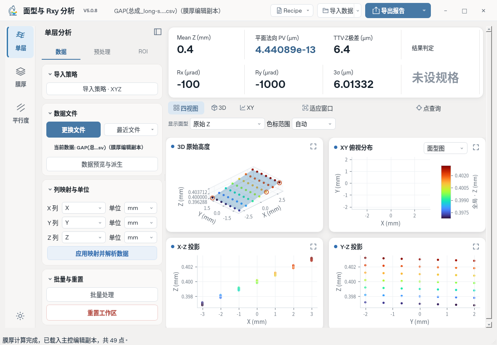
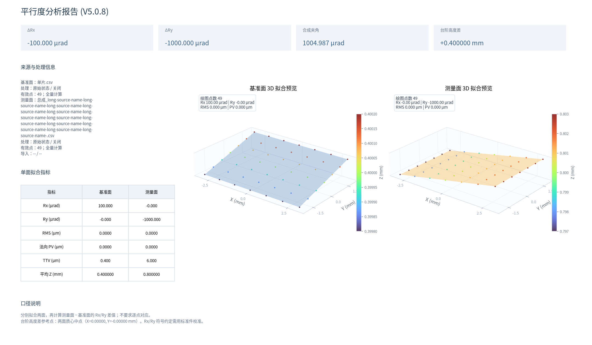
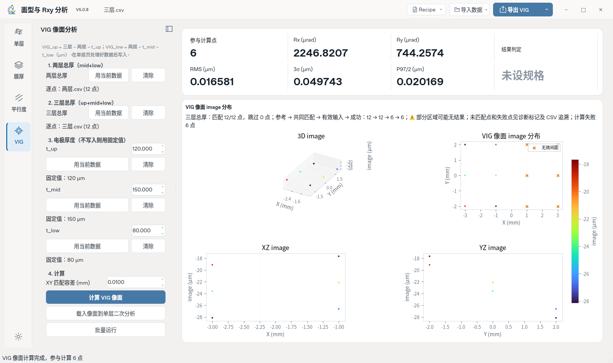

# V5.0.8 修改说明与验证

> 当前源码另有布局、搜索框配色及默认隐藏主控 3σ 的修订；本轮未打包／发布。请先查看 [布局修订与报告全图](V5.0.8_LAYOUT_REVIEW.md)。下文安装包及其验证属于前一轮构建。

本版基于 V5.0.7 审阅分支，主程序 V5.0.8，VIG 可选扩展 1.2.0（最低主程序 V5.0.8）。两个安装器均保留原 AppId。未自动合并主分支、创建 tag 或发布 Release。

## 1. 示例驱动的模块批量运行

膜厚、平行度及 VIG 页均提供“批量运行”。先完成一组分析并确认结果，再点击该按钮；确认每个槽写入时各自的单层参数、模块配置、文件关键词与输出策略，随后进入原有分组确认表，扫描每个直接子文件夹或配置单组。

**不必先保存 Recipe；当前示例测量点和旧结果不会复制给新文件。默认不重放手动删点。** ROI 与自动滤波按各槽参数重新计算；VIG 固定值电极复用固定值，文件模式电极必须每组提供文件。组合 Recipe 的保存、筛选、加载／运行集中在 Recipe 管理中，原有单层批量入口保持原用途。

逐组隔离、失败继续、取消、超时、质量策略及输出追溯继续沿用现有组合执行框架。任何角色缺失均不能沿用上一组文件。

## 2. 膜厚回到主控分析，平行度报告重排

膜厚模块保留数据层、配准页和匹配图；**计算成功后自动载入独立膜厚编辑副本并切换至单层主控**。膜厚页不再单独显示四视图。后续删点／撤销、ROI、滤波、显示面型、指标及导出报告均使用现有主控。模块内“载入结果到主控”可再次从原始扣减结果建立副本；这会重新载入原结果，应先导出需要保留的编辑结果。

主控编辑不重新匹配／扣减，不修改原始膜厚快照。报告保留来源、匹配点数、容差与配准偏移，CSV 元数据保留完整参数追溯。膜厚组合批量报告同样使用单层报告渲染器，不再输出五图专用报告。内存编辑副本不能伪装为可重放的源文件槽。

平行度报告使用已确认的布局：顶部差值指标，左栏来源和单面指标表，右侧原有两幅 3D 拟合图及各自色条，底部独立口径说明。来源区域随换行数量增加页面高度，计算定义不变。

## 3. 主控工具栏

“显示面型”“色标范围”标签按文字宽度紧贴对应下拉框，弹性空间放到末尾。保留现有窄窗口整组换行，以及原选择和色标规则。

## 4. VIG 物理输入检查与区域追溯

计算前检查电极厚度、VIG_up、VIG_low 均为正的有限数；无效点保存参考索引、XY、阶段和原因。所有点都无效时明确失败；部分有效时只计算有效点，保留部分结果警告。

界面／报告记录“参考输入 → 共同匹配 → 有效输入 → 计算成功”四阶段点数；XY 图叠加未匹配点、无效输入和光线失败点，不将它们着色成成功 image。CSV 保存逐点追溯，组合运行快照保存相同信息。参考索引指写入槽时的参考数组位置，不冒充原文件行号。

**部分结果不代表两条 slit 都成功参与计算。** 需要查看缺失点的空间位置及原因。未匹配与计算失败分开计数，不自动扩大容差或对负间距取绝对值。

VIG 光线公式、单位和符号不变；VIG 原指标拟合使用 `-image`，其 3σ 为去平面残差总体标准差的三倍。主控编辑副本保留 `image` 原符号，3σ 跟随显示面型；界面提示说明这一区别。

## 验证和限制

定向测试使用用例超时及进程总超时；不运行已知会卡住的完整套件。独立 `--check-v508` 验收使用隔离设置，实际渲染主控、膜厚主控报告、平行度报告、VIG 报告和部分区域诊断，并启动真实组合计算子进程。打包后 Windows 验收及隔离安装／升级由审阅构建完成，实际状态以 Actions 运行及交付包 JSON 为准。

本地正常 VIG 输入的 image、焦距、主平面位置、残差及最终指标与 V5.0.7 基线逐项完全相同。已有黄金数值用例 `test_golden_image_and_plane_outputs_match_original_tool` 在当前 Linux/SciPy 环境下有约 1.129e-7 µm 的误差，略超原 1e-7 µm 容差；旧引擎同样复现。**保留原断言，未修改公式或放宽容差；该既有失败单独披露，未混入“全部通过”的定向用例数。**

合成双 slit 用例覆盖两侧完整、单侧缺匹配及单侧无效间距；尚未取得用户真实 slit 文件，不能据此声称已定位其实际文件的唯一根因。用户设备高 DPI、真实鼠标窗口管理行为仍需人工复核。

## 实际页面与报告

全部实际操作页面见 [截图索引](v508-screenshots/README.md)。

最终下载、校验文件和 Windows 验证结论见 [交付与验证结果](V5.0.8_VALIDATION_RESULTS.md)。
