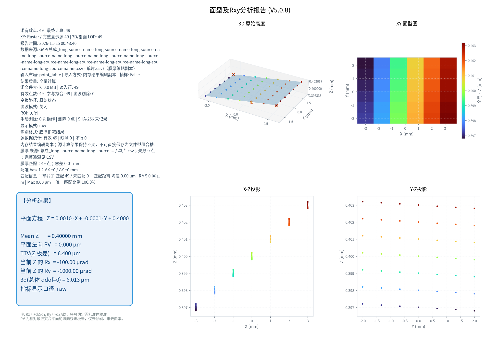
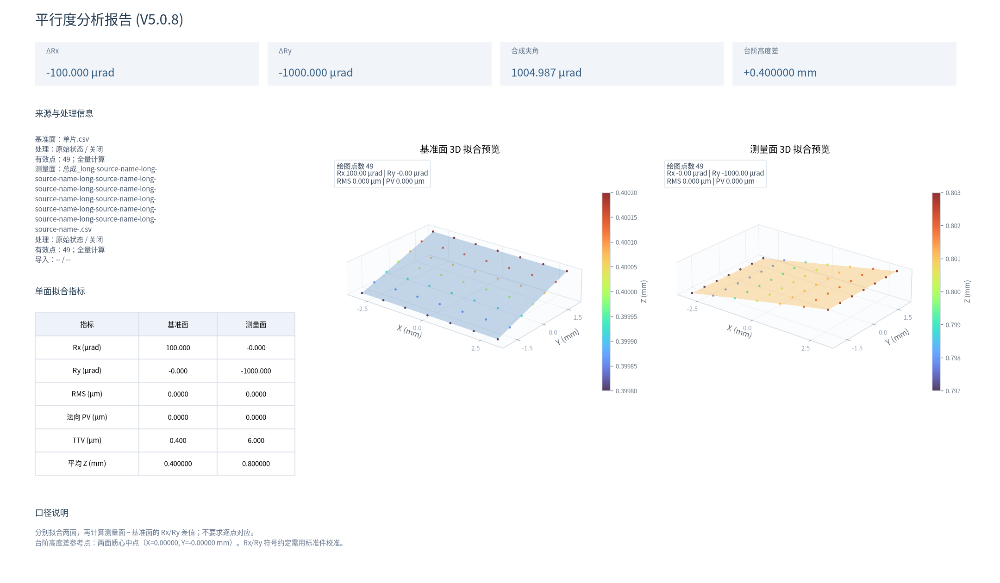
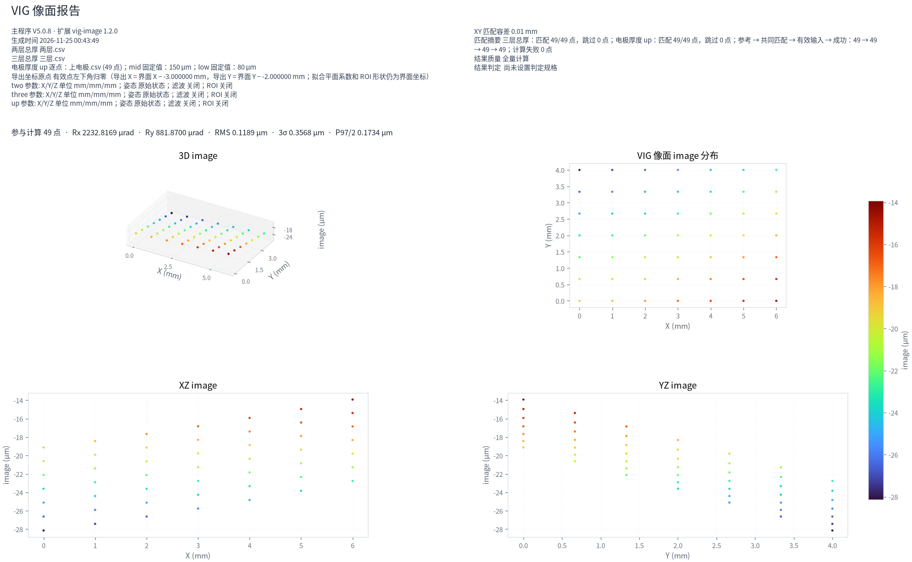
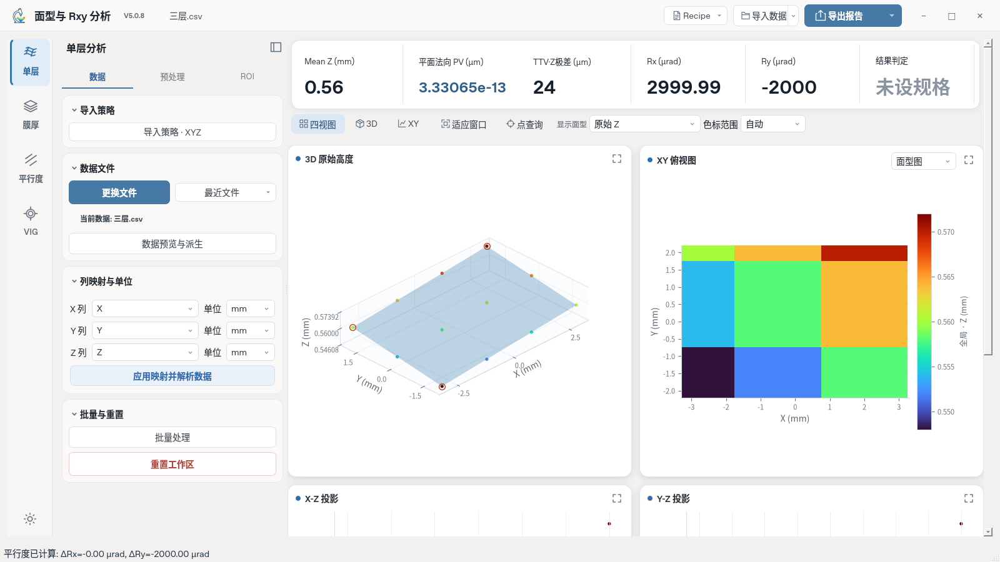
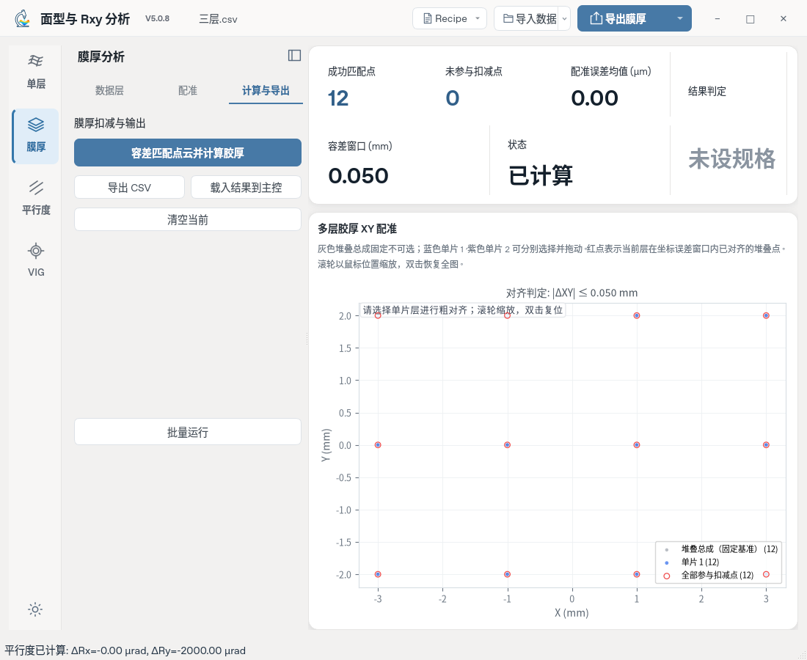
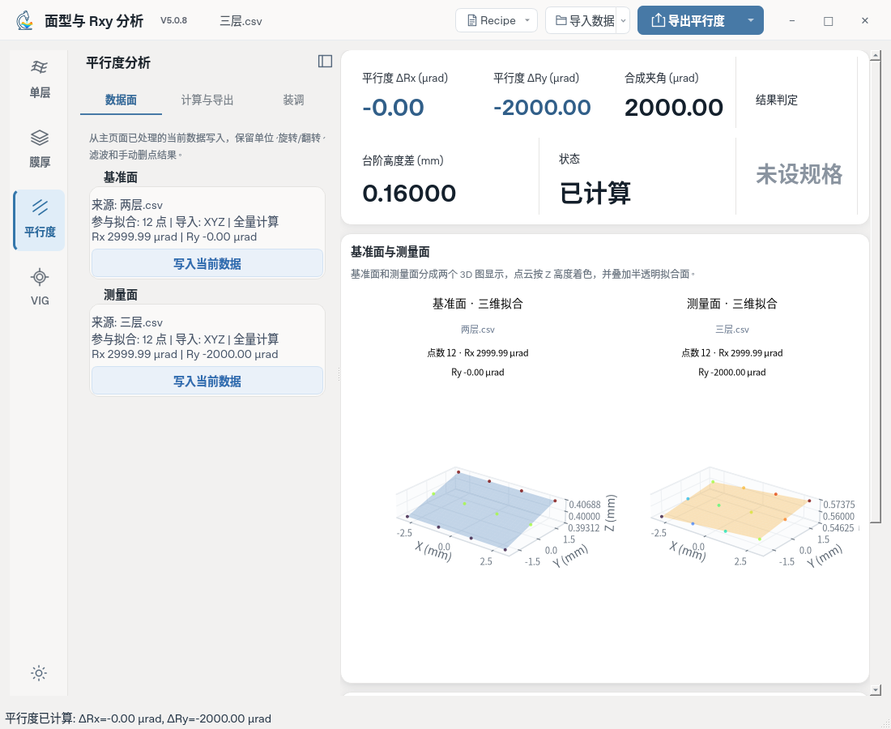
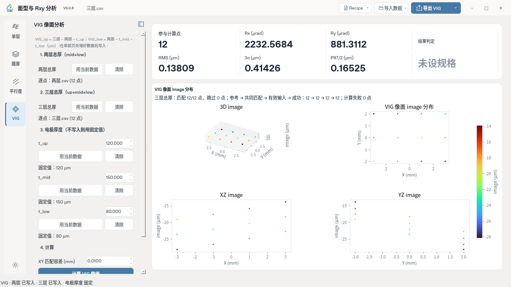

# V5.0.8 源码布局修订与实测截图

以下为发布前的源码审阅记录。用户确认后，这些修订已包含在 2026-11-25 发布的 V5.0.8 安装包中；正式下载、Windows EXE 报告及安装升级结果见 [发布验证](V5.0.8_RELEASE_VERIFICATION.md)。

源码分支：`fix/v5.0.8-layout-review`；功能提交：`3bf6fbd40dfbe84a662fcee5c82c812094c9cf3a`；四视图尺寸补充修复：`a578f248eb47da2071ae4e34bab08dbb0a5b2cc8`。

以下均为软件实际 Qt / Matplotlib 渲染，采用合成示例数据，非设计图。按要求先展示报告完整排版，再展示整体界面；可点击原图查看文字。

## 1. 报告完整排版

### 单层／膜厚主控报告

修正独立 Figure 的网格更新未同步到实际坐标轴的问题；3D 与 XY 标题同排，3D 适度放大并与下方 XZ 对齐。膜厚继续使用主控报告，匹配、配准和来源信息以文字保留。

[查看原图](v508-layout-review/main-report.png)

### 平行度报告

两幅三维图各自在分配区域内居中，缩回过大的场景，保留独立色条；来源、指标表和说明分区不相互覆盖。下面特意保留了长文件名场景，用于检查换行后的整体布局。

[查看原图](v508-layout-review/parallel-report.png)

### VIG 报告

共享色条不再把 3D 坐标轴锚定到右侧；保留原图形、单位、坐标、计算指标和质量信息。

[查看原图](v508-layout-review/vig-report.png)

## 2. 整体界面

### 主控默认界面

顶部默认显示 Mean Z、PV、TTV、Rx、Ry 和结果判定，**3σ 默认不勾选**。窄窗口按整张指标卡换行；不足一行时均分可用空间，判定区固定在右侧。数值和状态使用自适应字号。另修正窗口由窄变宽或放大视图后恢复时，画布首选高度造成不必要滚动的问题；1600×900 下四视图完整可见。

### 膜厚窄窗口

不再把六张指标卡强挤在一行；标题允许换行，数值及“未设规格”完整显示。

### 平行度窄窗口

原自动布局在窄窗口下可能把两个三维坐标区挤至极小，导致标题、坐标和说明重叠。现为三维图区、标题、来源和指标分别预留空间；长文件名按宽度省略，完整名称保留在悬停提示和来源区。

### VIG 整体界面

分组标题上方／下方预留空间，不再与首行控件贴合；顶部数值及判定自适应，3D 图横向居中。

## 3. 3σ 与 Recipe 的行为

- 启动默认不显示主控 3σ；其他指标仍默认显示，规格上限仍为空。
- 用户可在“判定规格 → 单层指标与规格”勾选 3σ。
- 主动加载保存了“显示 3σ”的 Recipe 时，会恢复显示；保存了隐藏状态时仍隐藏。
- 仅有一个未启用的旧上限，不能使隐藏指标参与判定。
- 本次改变的是主控启动默认；VIG 原模块指标定义和报告原有指标口径不改。

[默认未勾选](v508-layout-review/sigma-default-off.png) · [加载 Recipe 后显示 3σ](v508-layout-review/sigma-recipe-on.png)

## 4. Recipe 搜索框配色

当前基线源码中，未复现浅色输入文字与浅色背景相混的情况；但提示文字相对较浅。本轮为搜索框明确设置输入、提示、选中文字和背景颜色，并检查浅色 → 深色 → 浅色的往返切换。

实测对比度：浅色输入文字约 12.74:1、提示文字约 6.00:1、选中文字约 9.26:1；深色输入文字约 15.00:1、提示文字约 6.27:1。此结果只针对该控件，不代表整套软件已通过完整无障碍审计。

[浅色提示](v508-layout-review/recipe-light-placeholder.png) · [浅色输入](v508-layout-review/recipe-light-input.png) · [深色输入](v508-layout-review/recipe-dark-input.png) · [浅色选中](v508-layout-review/recipe-light-selection.png) · [配色测量](v508-layout-review/search-contrast.json)

## 5. 验证结果及边界

- 原有九个定向文件共 92 个用例，结合分组重跑通过；新增布局／主题／Recipe 的 9 个用例和报告布局 1 个用例通过（最终重跑 10 个用例，67.86 秒）。共覆盖 102 个不同的定向用例，并非声称执行了完整测试套件或一次性全通过。
- 组合流程初次回归出现 Qt 原生崩溃；调整布局回流和控件持有方式后，完整 29 个用例重跑通过。格式扩展初次未设置 offscreen 平台而中止，补充平台配置后 6 个用例通过。未削弱断言。
- `--check-v508` 源码验收通过：实际界面、主控膜厚报告、平行度报告、VIG 报告和区域诊断，以及真实 VIG 组合计算子进程；原结果和编辑副本隔离检查通过。
- 100% 与 150% 缩放检查了 1100、1366、1600 宽的四个模块；200% 检查了 1100、1600 宽的四个模块。检查图和文字后，扫描范围内没有剩余的普通标签截断项。
- [150% 平行度界面](v508-layout-review/parallel-150percent.png) · [200% 膜厚界面](v508-layout-review/thickness-200percent.png)。
- 所有截图为 Linux 源码运行结果；本轮按要求没有生成 Windows EXE、安装包，也没有执行安装／覆盖升级验证。原 VIG 黄金数值容差的既有问题仍见历史验证说明，本轮没有修改计算公式。

[验收记录](v508-layout-review/validation.json)。
