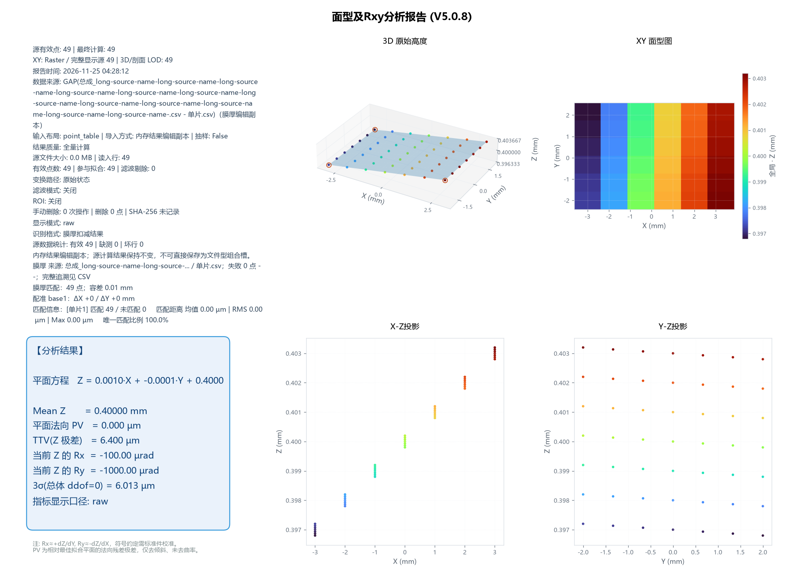
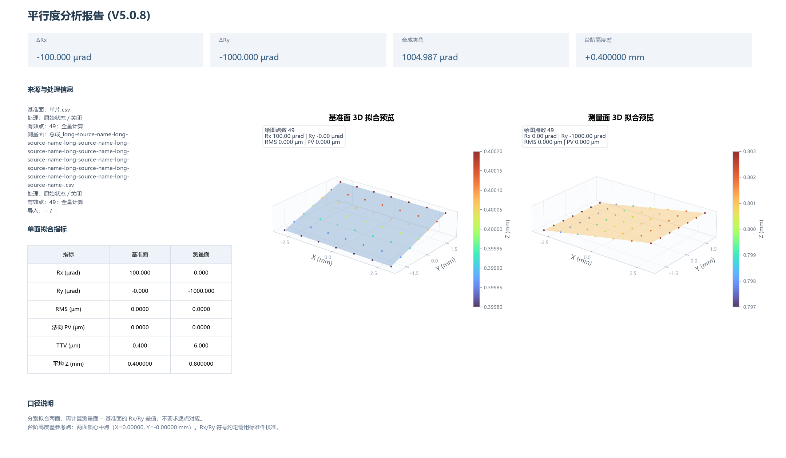
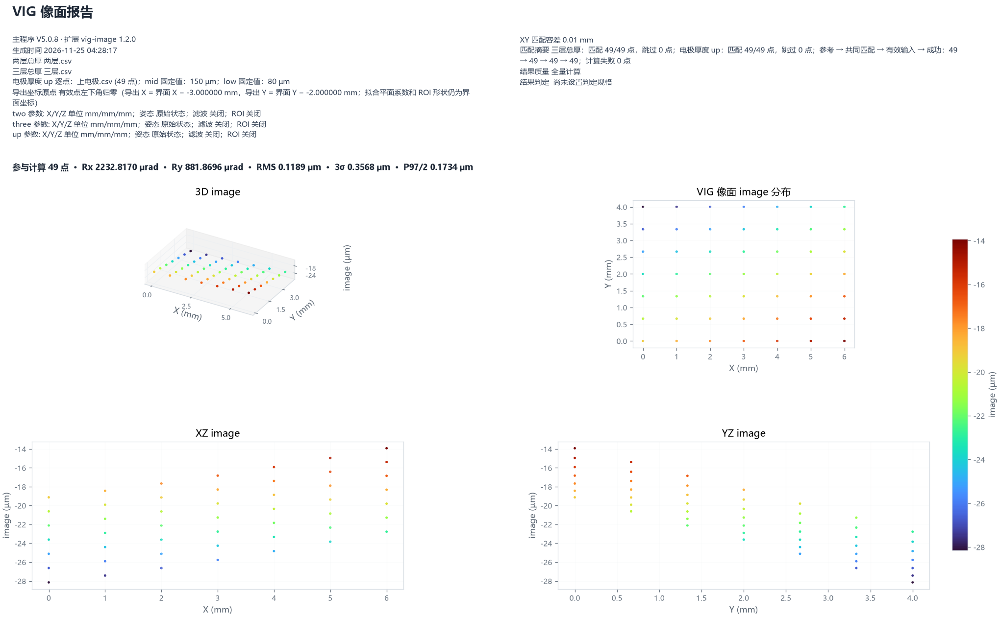
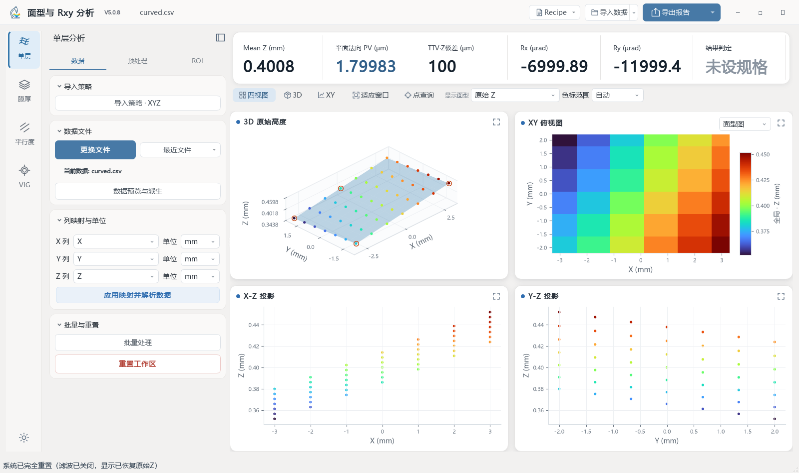

# V5.0.8 正式发布与下载核验

2026-11-25 UTC 已发布：[GitHub Release](https://github.com/imbingo/surface-rxy-zxy-analyzer/releases/tag/v5.0.8)；[成功的 Windows 发布任务](https://github.com/imbingo/surface-rxy-zxy-analyzer/actions/runs/45544870169)。

安装包程序源码提交：`5d59a8a306f4921e3170d2f36818bdd3222f2bea`（`v5.0.8` 标签）。主程序 V5.0.8；可选 VIG 扩展 1.2.0，最低主程序 V5.0.8。主程序和扩展均保持原 AppId。

Windows 门禁收集并通过 102 个定向用例，源码 GUI／报告／真实计算子进程、打包 EXE 有／无 VIG、主程序全新安装／V5.0.5 覆盖升级／数据保留／卸载，以及 VIG 1.0.0→1.2.0 安装升级验证通过。未运行完整遗留测试套件。

首次发布任务在升级基线检查处停止，没有发布附件：脚本当时将可变的 `origin/main` 当作 VIG 1.0.0。主分支合并后该假设失效。升级 QA 基线已固定为 `e4a715963cb63fa54946a157d6c98f4227898cd0`，重试任务仅从编排提交 `482a99a` 使用修正的升级 QA 脚本，程序／测试／安装包仍取原 `v5.0.8`，没有移动标签。

## 安装包 SHA-256

| 文件 | SHA-256 |
| --- | --- |
| `SurfaceRxyZxyAnalyzer_Setup_V5.0.8.exe` | `3661b8568a5bf7d15194dc577c9fe4e42017939f932ce357069822bdadf82066` |
| `SurfaceAnalyzer_VigImageExtension_Setup_V1.2.0.exe` | `7fe23ab810ee9744d9abae2db8cfd5b860dc6d80a164625a66c394e61e0f8e15` |

**使用 VIG 时请同时安装主程序和新版 VIG 扩展；无需 VIG 时只安装主程序。** 主程序不会自动替换可选扩展。

## 下载核验

已实际从正式 Release 分别下载主程序安装包、扩展安装包和验证资料包，核对三者 SHA-256、更新清单源码提交及资料包内 160 个文件的清单哈希。

验证资料包 SHA-256：`23b7c75a4373a40107e09d451d56143e9845cfbe53ebd98cfe3ba0d2478a9605`。

[构建摘要](v508-release-windows/validation-summary.json) · [安装包校验值](v508-release-windows/SHA256SUMS.txt) · [下载核验](v508-release-windows/download-verification.json)

## Windows EXE 实际报告与界面

以下使用合成示例数据，从本次打包 EXE 验收产物提取，并已打开检查。

历史 Linux 黄金数值容差差异、未取得用户真实 slit 数据等限制继续适用，见 [修改说明](V5.0.8_CHANGES.md)。本次合成数据及隔离安装验证不代表已在用户真实测量文件和设备上完成验收。
